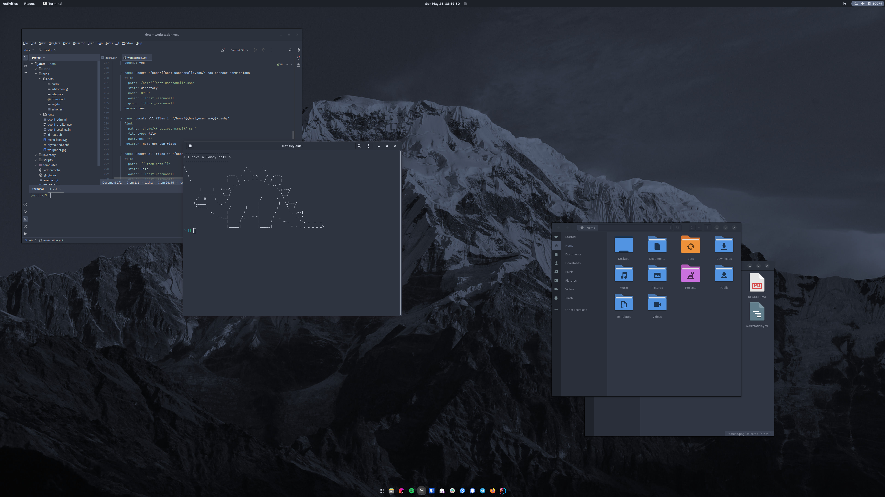

# .dots



*The screenshot above may or may not represent reality. What are you, some kind of a lawyer?*

New and upgraded dotfiles, now with Ansible!

## What is this?

This is an Ansible project I use to configure and maintain my personal workstations, install software, manage dotfiles,
set desktop defaults, configure SSH and firewalls, and generally make a fresh machine feel like mine again.

The main thing here is the Fedora desktop workstation playbook:
[`playbooks/workstation.yml`](playbooks/workstation.yml).

There are also headless and uConsole playbooks in the repository. They are here because I currently find them useful,
not because they are a stable public interface. The desktop playbook is the primary path. The other ones may change
wildly, bitrot, or disappear later.

## Danger, Will Robinson!

For obvious reasons, you **should not** apply this configuration on your own machine. Doing so **will break your stuff**,
**replace it with my stuff**, lock down parts of your system in ways you may not expect, and possibly **kill your cat**
or any other household pets you might have in the immediate vicinity.

You can definitely use this repository to bootstrap your own setup and to try it all out on a disposable virtual
machine.

If you fork this, do not add anything you want to keep secret to a public repository. This includes passwords, private
keys, tokens, VPN configs, private hostnames and such.

## Goals and non-goals

The goal is to configure my desktop environment on a fresh machine installation as fast as possible and with as few
manual steps as possible.

Having a production grade Ansible project is not a goal of this repository, however I will try my best to keep the
playbooks and related files somewhat maintainable for the benefit of my own, personal sanity. If you are looking for
examples on how to write production Ansible roles to be shared with others, this is NOT a good example. It might still
help you get started. Many shortcuts have been taken here because they are acceptable to *me*.

## What is automated

- Personal dotfiles, shell setup, oh-my-zsh, tmux and other small quality-of-life bits.
- Nearly all the software I use on my desktop workstation.
- Fedora repositories, RPM Fusion, Docker, HashiCorp, Proton VPN and Flatpak setup.
- Defaults for themes, fonts, wallpaper, GNOME dconf settings, GDM and extensions.
- Some security defaults, SSHD config, firewalld config and authorized keys.
- Docker, virtualization tools, development tools, media tools and general workstation things.
- A few opinionated home directory conventions.

## Current playbooks

The desktop playbook is the one I actually care about:

- [`playbooks/workstation.yml`](playbooks/workstation.yml) configures my Fedora GNOME desktop workstation.

There are two other playbooks:

- [`playbooks/workstation-headless.yml`](playbooks/workstation-headless.yml) configures a Fedora host without the full
  desktop setup.
- [`playbooks/uconsole.yml`](playbooks/uconsole.yml) configures my uConsole, currently as a Debian trixie-based target.

The headless and uConsole playbooks are there for my convenience. You can look at them, borrow from them, or use them if
they happen to fit, but I would not build anything important around them staying exactly as they are.

## Components

The desktop setup currently includes, among other things:

- GNOME desktop.
- Papirus icons.
- [IBM Plex](https://www.ibm.com/plex/) and [JetBrains Mono](https://www.jetbrains.com/lp/mono/) fonts.
- Docker and related container tooling.
- Flatpak and a handful of desktop applications.
- Development, networking, virtualization and media tools.
- ... software, tools, things.

### dconf settings and system defaults

Desktop user experience configuration is set as a system-wide default profile instead of using per-user settings. This
is done on purpose - not all of my machines are exactly the same and by using system defaults I can still override some
settings locally without having them later reverted by Ansible.

## How to use

### Using manual installation

1. Set up a machine with a basic Fedora GNOME installation.
   - SSH server is required if you plan to complete the installation remotely.
2. Move to a non-default TTY, use an existing terminal, or SSH into the machine remotely.
3. Install the bootstrap dependencies:

   ```sh
   sudo dnf install python3 git uv
   ```

4. Clone this repository somewhere. I usually use `~/dots/`.

   ```sh
   git clone https://github.com/your-user/dots.git ~/dots
   cd ~/dots
   ```

5. Let `uv` set up the project environment.

   The repository has a `pyproject.toml` and `uv.lock`. Ansible is managed there, because of course the dotfiles repo
   now has a package manager for the package manager for the machine manager.

   ```sh
   uv sync
   ```

6. Review and edit the inventory variables and desktop playbook as required.

At minimum, check [`inventory/group_vars/all.yml`](inventory/group_vars/all.yml), which contains the common personal
settings:

- `host_username`
- `ansible_user`
- `allow_ssh_users`
- `git_email`
- `git_name`
- `git_signing_key`
- `git_commit_gpgsign`
- `git_push_default`
- `authorized_keys`

Then check [`inventory/group_vars/workstation.yml`](inventory/group_vars/workstation.yml) for desktop-specific
overrides, and [`playbooks/workstation.yml`](playbooks/workstation.yml) for the actual tasks.

Also review the package lists and these files:

- `files/id_ed25519.pub`
- `files/dots/`
- `templates/dots/gitconfig`
- `templates/dots/authorized_keys`

Run Ansible in check mode first:

```sh
uv run ansible-playbook playbooks/workstation.yml -K --check --diff
```

Run Ansible against localhost:

```sh
uv run ansible-playbook playbooks/workstation.yml -K
```

Setup requires root privileges, but of course it does. Ansible will ask you for your password to become root user. This
is required because Ansible automates package installation, changes settings only accessible to root, manages services
and so on.

Once the playbook is applied, you might need to reboot. In practice, just reboot. Shell changes, group membership,
desktop defaults and service changes are easier to reason about after a clean login.

### Remote installation

I personally normally run this against `localhost` on the specific machine I want to set up. That is just my workflow.
It is neither right nor wrong; it is simply how I prefer to apply changes to machines that are sitting in front of me.

The default inventory uses a named local target that points the desktop playbook at localhost:

```ini
[workstation]
workstation_local ansible_host=localhost ansible_connection=local ansible_python_interpreter=/usr/bin/python3
```

If you want to run this against a remote host, you need to modify the inventory carefully. At minimum, edit
[`inventory/hosts`](inventory/hosts), remove the `ansible_connection=local` argument, and check `ansible_user` in
[`inventory/group_vars/all.yml`](inventory/group_vars/all.yml). If the SSH user is different from `host_username`, set
that explicitly. Also make sure the remote user can SSH into the target and become root with sudo.

Do not treat remote installation as a copy-paste variation of the localhost command. Read the playbook first, check
which host group you are targeting, and make sure you are not about to redecorate the wrong machine.

### How to modify and use

1. Fork this repository.
2. Review and modify [`inventory/group_vars`](inventory/group_vars).
3. Review and modify [`playbooks/workstation.yml`](playbooks/workstation.yml).
4. Review and modify [`files`](./files) and [`templates`](./templates).
5. Commit and push your changes to your fork.
6. Follow the "How to use" steps above.

## Things not really meant for you

- The headless playbook.
- The uConsole playbook.
- My exact package list.
- My SSH keys, Git identity, shell preferences and directory layout.

You may still find useful pieces in all of the above. Just do not mistake "present in the repository" for "intended to
be reusable as-is".

## Known issues

- During initial setup, `dconf update` might not be executed properly and might need to be run a second time manually
  after all changes are applied. Simply sign in and run `sudo dconf update`.
- The main playbook assumes Fedora. The uConsole playbook assumes its own Debian-based setup. Mixing those up is a
  creative way to have a bad afternoon.
- This is personal automation. I try to keep it readable because future me will otherwise be annoyed, but there is no
  compatibility promise beyond my actual machines.

## Disclaimer

This repository and its contents can and will change at any time, for no reason, and with no explanations. Files may
move, playbooks may disappear, defaults may change, and something that worked yesterday may be gone tomorrow because I
felt like it.

I hold no responsibility for any use, misuse, creative interpretation, accidental execution, intentional execution, or
other adventures involving this repository. If it breaks your stuff, please refer back to the section titled "Danger,
Will Robinson!".

## Credits

Wallpaper (c) 2020 [Kristaps Ungurs](https://unsplash.com/@kristapsungurs)

## FAQ

### What about syncthing?

If you have one main machine and one secondary machine, and you only ever make changes to one of them, sure, you can use
syncthing for dotfiles. You are limited to syncing files only. Overall I do not recommend this.

If you have more than two machines to configure, and you are looking to use syncthing to sync your configs and dotfiles,
you probably should not. Or do if you like to break your stuff.

### What about git?

This project also uses git. And in theory, you could just `.git` and `#!/bin/bash` your home directory together - but
why? This is so much easier to maintain.

### What about other 5,000 tools someone created to configure their machines/dotfiles?

At the end of the day, you can use whatever approach fits you best. Ansible is a standard tool used by countless system
administrators, ops professionals and developers for things much more serious than this. So you would be in good
company, and there are few things you can't do with Ansible in {insert current year}.

### Does Ansible work on Apple?

Sure does. Homebrew package management, config file management and plenty other included.

This repository does not currently target macOS. The main path here is Fedora desktop.

### But but but my bootstrap scripts and manual copy-pasting of everything?!

Haha Ansible playbooks go brrr
